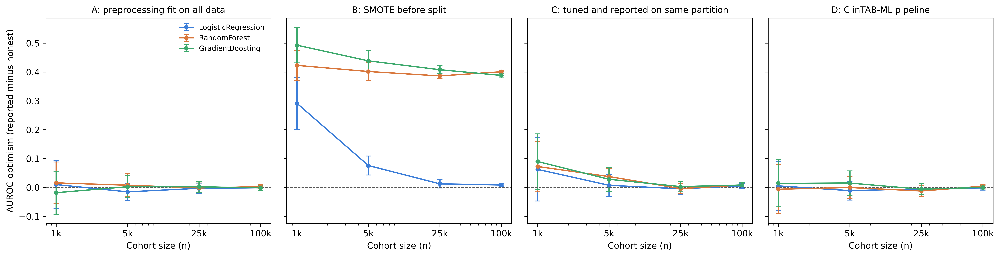

# Summary

ClinTAB-ML is a Python application for building and testing clinical prediction models on tabular data, for example an extract from a surgical or trauma registry or a single-centre cohort. The user uploads a CSV file and, from one web page, can profile the columns, split the data into training, validation and test sets, train and tune up to 15 models, evaluate them with discrimination and calibration plots, fit restricted cubic splines, and run common epidemiological calculations such as odds ratios, number needed to treat, Kaplan and Meier curves and Cox models. The application is a Flask server that runs on the user's own computer, and the same functions can be called from a command-line interface. Each analysis step is saved to a log, and from that log the software writes a draft methods paragraph and a checklist based on the TRIPOD+AI reporting guideline [@collins2024tripodai].

# Statement of need

Surgical and trauma registries such as the American College of Surgeons National Surgical Quality Improvement Program and the Trauma Quality Improvement Program are used in a large number of outcome studies [@ko2015acsnsqip; @shafi2009tqip]. When these studies develop a prediction model, the analysis is usually spread over several tools. Data exploration happens in a notebook, model comparison in custom scikit-learn code, odds ratios in an online calculator, and survival analysis in yet another package. Methodological errors are easy to introduce when work moves between these tools. Tuning hyperparameters on the data used to report performance, oversampling before splitting, and fitting preprocessing steps on the full dataset all leak information and overstate model performance, and this has been found in many published machine learning studies [@kapoor2023leakage]. Calibration is also often missing from clinical prediction papers, although a model with poor calibration gives misleading risk estimates for individual patients [@vancalster2019calibration].

Data governance is a further constraint. Online calculators and hosted machine learning platforms need the data to be uploaded to an outside server. Registry extracts are often not fully de-identified and come with data use agreements that do not allow this.

ClinTAB-ML was written for clinical researchers, including residents, students and clinicians with little programming experience, who need to develop and evaluate a model on data that cannot leave their computer. Leakage-free tuning, oversampling of the training fold only, and calibration testing are the defaults, so a user does not need to know about these problems in advance to avoid them.

# State of the field

ClinTAB-ML does not implement its own statistical methods. Models come from scikit-learn [@pedregosa2011sklearn], SMOTE from imbalanced-learn [@lemaitre2017imblearn], survival models from lifelines [@davidsonpilon2019lifelines], splines and generalized linear models from statsmodels [@seabold2010statsmodels], and data handling and figures from pandas, NumPy, SciPy and Matplotlib [@mckinney2010pandas; @harris2020numpy; @virtanen2020scipy; @hunter2007matplotlib]. Using these libraries directly requires the researcher to write the whole analysis. Orange [@demsar2013orange] offers a visual interface to similar methods, but it is aimed at general data mining and has no epidemiological calculators, Hosmer and Lemeshow test, or reporting support for clinical prediction models. Commercial and cloud automated machine learning services train many models with little effort, but the data are processed on remote servers, and model selection is based on predictive performance with no attention to the reporting that clinical journals require.

Adding these features to Orange or to a cloud service would not have met the main requirement, which was that registry data stay on the researcher's machine. We therefore wrote a small application around the existing libraries that keeps model development, the related epidemiological analyses and a record of the analysis in one place.

# Software design

The HTTP layer is kept apart from the analysis code. `app.py` starts the Flask application and `routes.py` holds the endpoints. The analysis code is in the `clintab` package and none of it imports Flask. `stats.py` detects column types and summarizes the data, `ml.py` contains the model catalogue, preprocessing, tuning and metrics, `spline.py` fits restricted cubic splines, `epi.py` contains the epidemiological functions, `plots.py` draws the figures and `store.py` handles files on disk. The command-line interface in `clintab_cli.py` calls the same functions as the web application, which means results are identical in both and the analysis modules can be tested without starting a server.

Hyperparameter search by default uses a predefined split. Each candidate is scored on the validation set, and the chosen settings are then refit on the training set alone, so the reported validation metrics come from data the model was not fit on. On small datasets a single validation split can make this selection unstable, and the user can switch to k-fold cross-validation within the training set. Preprocessing is fitted inside each model pipeline, and SMOTE [@chawla2002smote] is applied to the training fold only. For binary outcomes the software reports AUROC, AUPRC, sensitivity, specificity, positive and negative predictive value, F1 and Brier score, and draws ROC, precision-recall and calibration plots. Calibration of a saved model can also be checked with the Hosmer and Lemeshow test [@hosmer1980goodness]. Splines are fitted as logistic generalized linear models on a natural cubic regression spline basis from patsy, with 3, 4 or 5 interior knots placed at the quantiles recommended by Harrell [@harrell2015regression]. When a two by two table contains a zero cell, the Haldane and Anscombe correction is applied [@haldane1956estimation].

Every session has an analysis log in JSON Lines format. Entries are only ever appended, and each training run, model test, spline and epidemiological calculation is stored with its inputs and main results. `methods_text.py` turns the log into methods text using fixed sentence templates. No language model is involved, and a given log always produces the same text. `tripod_report.py` checks the log against a subset of the TRIPOD+AI reporting items and labels each one as found, not found or needing manual review. Some items, such as the study rationale and limitations, cannot be confirmed from a log, and the report says that it does not replace the published checklist.

Tests cover the analysis modules, the log, the methods text and the TRIPOD+AI report. GitHub Actions runs them on Python 3.10 and 3.12 for each push and pull request.

# Validation

We ran four experiments on a MacBook Air with an Apple M2 processor and 8 GB of memory, and no network access was used for computation. Experiments 1, 3 and 4 used patients who underwent total hip or total knee arthroplasty in the ACS NSQIP Participant Use Data Files for 2021 to 2023 (n = 292,373), with 30-day unplanned readmission (2.8%) as the outcome.

Experiment 1 tested whether the default pipeline prevents optimistic performance estimates. We drew random samples of 1,000, 5,000, 25,000 and 100,000 patients and, with 20 random seeds each, trained logistic regression, random forest and gradient boosting models under four protocols: preprocessing fitted on all data before splitting, SMOTE applied before splitting, hyperparameters tuned and performance reported on the same partition, and the ClinTAB-ML default pipeline. For each run we compared the performance the protocol would report with performance on patients held out from every development step. With SMOTE applied before splitting, reported AUROC exceeded held-out AUROC by up to 0.49 for gradient boosting and 0.42 for random forest, and for these two models the gap remained near 0.4 at n = 100,000. Tuning and reporting on the same partition inflated AUROC by 0.06 to 0.09 at n = 1,000, and this bias was no longer present at n = 25,000. Fitting preprocessing on all data had little effect in this dataset. Under the ClinTAB-ML pipeline, mean AUROC optimism ranged from -0.012 to 0.015 and mean calibration slope optimism from -0.056 to 0.079 across all sample sizes and models (\autoref{fig:optimism}).

Experiment 2 compared the statistical functions with reference values computed in R 4.6.0 with the epitools, survival, ResourceSelection and rms packages [@rcore2026]. AUROC, AUPRC and Brier score matched their reference values exactly. Odds ratios, risk ratios and their confidence intervals, chi-square tests including a table with a zero cell, Cox hazard ratios and concordance, and the Hosmer and Lemeshow statistic agreed to within 5 × 10^-5^, which is the precision at which ClinTAB-ML rounds its output. The restricted cubic spline did not match rms. The AIC differed by 2.07 and the fitted log-odds curves differed by up to 0.91, because patsy adds knots at the minimum and maximum of the predictor in addition to the requested interior knots.

Experiment 3 measured runtime and memory for cohorts of 1,000 to 292,373 patients. A full analysis, from splitting the data through generating the methods text and TRIPOD+AI report, took a median of 1.7 seconds for 1,000 patients, 10 seconds for 10,000 patients, 3.9 minutes for 100,000 patients and 8.7 minutes for the full cohort, with peak memory of 1.5 GB for the full cohort. Most of this time was spent training the random forest and gradient boosting models. Logistic regression took 3.8 seconds on the full cohort, and the methods text and TRIPOD+AI report each took less than 2 milliseconds.

Experiment 4 was a complete analysis of the full cohort in the application. The data were split into training (n = 204,661), validation (n = 43,856) and test (n = 43,856) sets stratified on the outcome, and SMOTE was applied to the training fold. On the test set, logistic regression had an AUROC of 0.666 and an AUPRC of 0.060, compared with 0.632 and 0.046 for random forest and 0.635 and 0.046 for gradient boosting. The Hosmer and Lemeshow test showed that the logistic regression model was poorly calibrated (statistic 38,468, p < 0.001). This is expected after oversampling, which inflates predicted risks [@vandengoorbergh2022harm]. The TRIPOD+AI report marked 8 items as supported by the log, 11 as needing manual review and 3 as not applicable.

# Research impact statement

# AI usage disclosure

Claude (Anthropic) was used to aid in code review and editing.

# Acknowledgements

The American College of Surgeons National Surgical Quality Improvement Program and the hospitals participating in the ACS NSQIP are the source of the data used herein; they have not verified and are not responsible for the statistical validity of the data analysis or the conclusions derived by the authors.

# References
